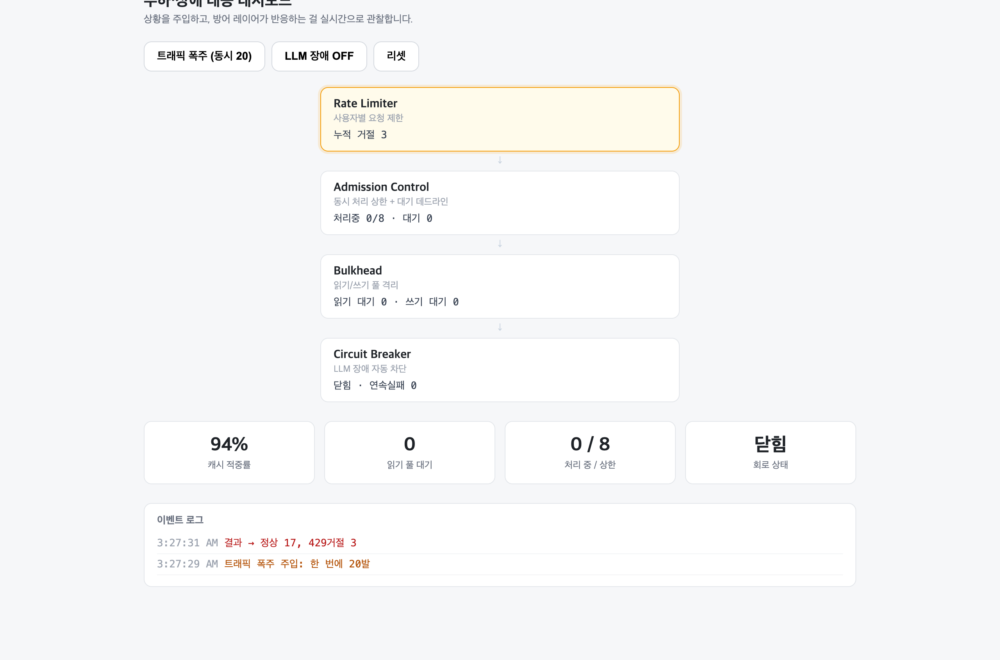

[한국어](PORTFOLIO.md) | [日本語](PORTFOLIO.ja.md) | **English**

# DocChat

A RAG chatbot that answers only from the documents you upload.
It refuses questions the documents don't cover instead of inventing an answer, and
shows the sources behind every answer. A real-time chat where several people talk
in the same room sits on the same server.

- Period: 2026.06 ~ 2026.07
- Team: solo (design · development · testing · documentation)
- Repository: https://github.com/JINWORLD13/docchat
- Stack: TypeScript · React (Vite) · Node/Express · PostgreSQL + pgvector ·
  Socket.IO · Gemini API · Docker
- Local run: the three steps under [Running](#running)

---

## Demo

### Every answer comes with its evidence


(The demo UI is in Korean. The captions here describe what each screenshot shows.)

Ask a question and the documents used plus their similarity scores (0.75, 0.67)
appear first, with the answer streaming in character by character below them. The
[1], [2] at the ends of sentences map straight onto the source numbers above.
Input and output tokens are recorded too, so cost is tracked.

### If it's not in the documents, it doesn't make it up


If the top similarity from retrieval falls below the threshold (0.62), it refuses.
The LLM is **not even called** — that blocks the nonsense and saves tokens and
latency at the same time.

### Real-time chat running on the same server


Pick a nickname and you can create or choose a room from the lobby. Headcounts in
the room list, connected users, join notices, and the indicator that someone else
is typing all travel over a single socket. Rooms vanish when they empty out —
there's no way to leave an empty room in the list, which is why creating a room and
joining one are the same action.

Answer tokens are SSE (one-way) and chat is WebSocket (two-way, 1:N), so they're
different in nature, but there's only one process. Why I didn't split them is under
[Architecture](#architecture) below.

### Load and failure dashboard

If you can't see *when* the defense logic fired, you can't make a judgment during
an outage. So I built a screen that injects the situation with a button and lets me
watch the reaction live.



Fire 20 requests at once and the Rate Limiter blocks with 429 whatever exceeds the
tokens left in the bucket (17 through, 3 rejected). The circuit stays closed and
the service is fine.

The bucket capacity is 10, so arithmetically 10 should have been blocked, but only
3 were. The browser opens at most 6 concurrent connections to one origin
(HTTP/1.1), so the 20 requests couldn't all leave at once and trickled out over
roughly 2 seconds. Tokens refilled at 5 per second in the meantime, and most got
through. I'm writing this down because it's the point where the theoretical number
and the measured one diverge — what you generate load with *is* the measurement
condition. `MODE=burst node scripts/demo-defense.ts`, which doesn't go through a
browser, produces a rejection count close to the theoretical one under the same
limit.


Inject an LLM outage and consecutive failures accumulate until the Circuit Breaker
opens (red); after that, requests respond degraded (sources only) without calling
the LLM. **0 hard errors out of 20** — the user loses only the summarized answer
and still gets the relevant documents.

The reasoning and the measurements are in [RELIABILITY.en.md](RELIABILITY.en.md).

---

## Architecture

```
  Browser (React)
     │  question (POST, answer over SSE) · chat (WebSocket) · image (POST → id)
     ▼
  Express server + Socket.IO  (one process · same port 4000)
     │
     ├─ chat: socket → flood limit (Token Bucket) → broadcast to the room
     │
     ├─ image: HTTP upload → format from leading bytes (SVG excluded) → store
     │         id only on the socket · server builds the URL · own pool (mediaPool)
     │                                  │
     ├─ ingest: file → chunking (overlap) → embedding → store
     │                                  │
     │                                  ▼
     │                         PostgreSQL + pgvector
     │                         (documents · chunks+vectors · query logs · chat images)
     │                                  ▲
     └─ ask: question → embedding → vector search top5
                                │
                                ├─ similarity < 0.62 → refuse (no LLM call)
                                │
                                └─ passes → excerpts into the prompt, generate
                                              │
                                              ▼
                                     Gemini API (generation, streaming)
```

The document Q&A is two flows. The ingest flow (chunk → embed → store) and the
question flow (retrieve → decide whether to refuse → generate). The generation call
is just the last piece; the retrieval and the refusal in front of it are the body of
this project. Chat differs only in transport, rides in the same process, and shares
defense logic like rate limiting with the document Q&A.

---

## Technical choices and why

pgvector as the retrieval store.
Attaching a dedicated vector DB (Pinecone and friends) adds one more piece of
infrastructure, and splits document metadata into Postgres and vectors into a
separate database, which makes them annoying to keep in sync. pgvector is one more
`vector` column in Postgres, so a metadata join and a vector search finish in one
SQL statement. At personal or small-to-mid scale, this side is simpler.

Overlapping chunking.
Documents are cut at 200 words with 40 words of overlap. Without the overlap, a
sentence like "refunds take 3 to 5 days" gets cut in half at a chunk boundary and
no chunk holds the whole answer. The overlap is insurance for sentences that land
on a boundary.

Refusing on a similarity threshold.
Forcing unrelated excerpts into the prompt and generating anyway produces
convincing nonsense. So when the top retrieval similarity is below the threshold, it
refuses without calling the LLM. That blocks the nonsense and saves tokens.

Answers over SSE, chat over WebSocket.
One app with two "real-times" that aren't the same thing. Answer tokens flow one
way, server to client, 1:1, so SSE is enough — it runs on plain HTTP, so proxies and
reconnection come free. Chat is bidirectional and has to push one person's message
to the whole room (1:N), so WebSocket is the right fit. The transport wasn't a
matter of taste; the direction the data needed to go decided it.

Even so, I didn't split the server.
"The transports differ" and "there's a reason to split the process" are different
statements. Socket.IO is attached to the same Express HTTP server, keeping port,
deployment, and CORS as one thing, and the defense logic is shared. Only after
merging did the duplication show up — the HTTP request limit and the chat flood
limit each had their own copy of the same Token Bucket. I pulled it out into
server/tokenbucket.ts, had both share it, and gave them different values (HTTP is
capacity 10, refill 5 per second; chat is 5 and 2).

The rule behind those numbers isn't "how expensive is the request" but "how far does
the damage spread when it overflows." By cost alone the HTTP question path is far
more expensive — it carries embedding and generation — and I still gave chat the
narrower burst. Flooding over HTTP gets your own requests 429'd and stops there; one
person flooding a room covers everyone else's screen in it.

One process is enough because most of what this server does is wait. The heavy work
— embedding, vector search, generation — all runs on other machines, and Node waits
for the result. Open SSE responses and sockets don't burn CPU while they sit there
either; they hold a file descriptor and a little memory. So adding processes adds
nothing — it just splits the waiting. The condition that breaks this assumption is
equally clear: synchronous work that actually holds the event loop stops every
connection at once, so adding PDF parsing or image conversion is where a worker or a
separate process becomes necessary. Today the only CPU work is comparing a few
leading bytes of an image and splitting strings for chunking.

There's a price. One process means one failure domain: when a single socket payload
killed the process (below), what died with it wasn't only chat — it was the document
Q&A. So the isolation was built inside the process rather than between processes —
the Bulkhead that splits the connection pool into read, write, and media (readPool,
writePool, mediaPool). Splitting processes and isolating resources are different
axes, and the second one works inside a single process.

The time to split is when the two kinds of traffic diverge enough in volume that
they need to scale independently.

I keyed the bucket on socket.id, tore it out, and then tore it out once more.
At first I gave each socket its own chat bucket and reclaimed it exactly on
disconnect with `drop()`, which I thought was cleaner than keying on IP. The
reclamation was clean. The limit blocked nothing. `socket.id` is new on every
connection, so "fire 5, disconnect, reconnect" gets you a brand new full bucket
every time. The limit wasn't on flooding speed at all; it was on reconnection speed.
So I changed the key to something that follows you across reconnects (the IP).

I wrote "fixed" in the docs at that point, and when I measured again later it wasn't
fixed. Because I'd left the reclamation on `drop()` — I counted live sockets per IP
and deleted that IP's bucket when the last one disconnected. For someone connected
alone, that "last socket" is themselves, so the budget vanished the moment they
disconnected and came back full when they reconnected. I'd changed the key and left
the bypass intact. Measured over the same wall-clock time with the same volume: 9
messages went out on a held connection while 20 went out by disconnecting and
reconnecting.

Two rules came out of it. **Key on something the attacker can't change, and make
the limit outlive the connection.** Knowing a connection ended doesn't entitle you
to forget the budget that person spent — the disconnect signal is a fine reason to
schedule reclamation and the wrong reason to erase a limit. So reclamation moved to
the same idle `sweep()` the HTTP side uses, and the behavior ("disconnecting and
reconnecting doesn't give the budget back") is pinned by a test. On top of that
there's a cap on concurrent connections per IP, which closes the other route —
multiplying the limit by opening several connections.

Images are identified by their content, and SVG isn't accepted at all.
The format of an image posted to chat isn't decided by filename or Content-Type.
Both are values the client writes, so `evil.html` can arrive named `cat.png` with
type `image/png`. So I read the fixed signature at the head of the uploaded bytes
(magic bytes) myself and let only png, jpg, gif, and webp through
(server/imagetype.ts). The extension comes out of that decision too. Leaving SVG
off the allow list is the same judgment — SVG is XML, so it can contain `<script>`,
and the moment we serve that file back to a browser from the same origin, it's
stored XSS. Accepting only raster formats makes the whole problem disappear, and it
fits the magic-bytes approach (SVG has no fixed signature). Responses also carry
`X-Content-Type-Options: nosniff`, which closes the path where the browser ignores
the type we set and sniffs the content to decide for itself. Keeping the detector as
a pure function is what let me pin "does it reject what it should reject" with 8
unit tests.

Bytes don't ride the socket, and the server builds the URL.
Images are uploaded over HTTP first (POST /api/chat/image) and only the issued id
goes over the socket. Put bytes on the socket and one photo is copied once per
person in the room, and the last-50-messages history in memory fills up with whole
photos. The upload returning an id and not a URL is deliberate too — if the client
could choose the URL, it could spray something like
`https://evil.example.com/tracker.gif` across the whole room and make everyone's
browser send a request to somebody else's server. The server checks that the id it
received is one it issued before it attaches a URL. Storage is `bytea` in Postgres
`chat_images`, and fetching is isolated on a dedicated pool (mediaPool) rather than
the read pool. Image fetches are frequent, heavy reads that fire every time a
message renders, so putting them on the question-retrieval read pool lets one
photo-heavy room starve the exact path this project said it would defend. Since the
`id` is a uuid and the content never changes, they can carry an immutable cache
header, so only the first request for each image reaches the DB.

TypeScript, with no build step.
The server and the frontend are both TypeScript, but there's no build output. Node
24 strips the types at run time, so `node index.ts` runs directly, and `tsc` only
checks under `npm run typecheck` (noEmit). No dist/, no separate runtime like tsx.
The price is that relative imports have to spell the real filename (`./db.ts`) —
Node won't rewrite `./db.js` into db.ts for you. The frontend still needs Vite to
bundle, so it builds with `tsc -b && vite build`.

What the move actually bought.
Two concrete things, not abstract safety. One, I put the shape of the
`/api/metrics` response in one place, `MetricsResponse` in server/types.ts, and had
the server, the measurement scripts, and the dashboard share it — which is how
compilation surfaced that after Bulkhead split the DB pool into read and write, the
load measurement script was still reading a `m.pool.total` that no longer existed.
In JS it just printed undefined on screen and nobody noticed. Two, I pinned the
socket event contract in generic types. HTTP gives you a 404 for a wrong path, but
socket event names are strings, so writing `"typeing"` instead of `"typing"` raises
no error and silently does nothing. The payoff from types is bigger there than on
the HTTP side.

---

## Problems I hit, and how I solved them

### 1. I set the refusal threshold from data, not instinct

I started with a threshold of 0.5, and an unrelated question like "capital of
France?" scored 0.53 and sailed through the gate.

Instead of nudging it up on instinct, I actually threw 5 related questions and 4
unrelated ones at the sample documents and measured the similarities.

```
related     0.662 ~ 0.744
unrelated   0.527 ~ 0.587
```

There's a clear gap between the two distributions, so I set the threshold in the
middle at 0.62. And I didn't hardcode it — it's an environment variable, so I can
retune it from the similarity each question leaves in query_logs.

### 2. I rode out transient errors from an external API with retries

During development I watched the embedding API return a 503 (temporarily
unavailable) and take an answer down with it. I split the handling: retry only
transient errors (429, 5xx) with exponential backoff, and fail immediately on
errors that retrying can't fix, like 400 and 404.

```ts
const RETRYABLE = new Set([429, 500, 503, 504]);

async function withRetry<T>(fn: () => Promise<T>): Promise<T> {
  const delays = [500, 1000, 2000];        // 0.5s → 1s → 2s
  for (let attempt = 0; ; attempt++) {
    try { return await fn(); }
    catch (e) {
      const wait = delays[attempt];        // undefined = retries are used up
      if (!RETRYABLE.has(statusOf(e)) || wait === undefined) throw e;
      // jitter: scatter requests that failed together so they don't all come back at once
      await new Promise((r) => setTimeout(r, wait / 2 + Math.random() * wait));
    }
  }
}
```

### 3. I found the places where the docs had run ahead of the code, and walked them back

This is the biggest thing I learned on this project. Every time I built a defense
layer I wrote down in the docs what it blocked, and when I later went back and
actually attacked those claims one by one, **four of them weren't blocking
anything.** That's a worse state than the code being wrong — I'd written down that
the wrong thing was right.

| What the docs claimed | Reality | Why they diverged |
|---|---|---|
| "trust proxy is pinned to 1" | Code default is 0, and the deploy config has no value at all | I fixed the code safely and forgot to carry it into the deploy config |
| "socket origins are locked" | Anything could connect from any origin | The `cors` option only attaches headers, it doesn't reject, and WebSocket isn't subject to CORS |
| "the reconnect bypass is closed" | Disconnect and reconnect and the budget resets | I fixed the key, but the reclamation code brought the bypass back |
| "closing the tab aborts generation" | Upstream generates to the end (and bills for it) | Breaking out of `for await` doesn't close an HTTP response that's already open |

The pattern is visible. All four diverged **not inside logic I wrote, but at the
boundary where that logic meets something else** — a framework setting, a library's
default behavior, the deploy environment, an SDK's cancellation contract. Tests were
guarding the logic. Nobody was watching the boundaries.

So I changed two things. One, every behavior I claim now has a test attached (three
of the four above are held today by `clientip.test.ts`, `origins.test.ts`, and
`realtime/ratelimit.test.ts`). Two, before fixing anything I reproduce it by
actually attacking it — connecting a socket from a malicious origin, firing requests
with varying XFF headers, deleting someone else's message under their nickname, and
pushing memory from 130MB to 300MB with a single request carrying hundreds of
thousands of fields (four of those at once peaked at 550MB; the free tier cap is
512MB). If you can't reproduce it, you can't tell whether your fix fixed it.

### 4. I separated the display name from what authorization rests on

Chat's "delete room" and "unsend" were authorized by nickname. With no login I
figured that was the only identity available, and I wrote that limitation into the
docs.

The problem was that it wasn't a plain limitation — it was a bypass around
destructive operations. Nicknames are fully public in the bubbles, the connected-user
list, and the room list; message ids are broadcast to the whole room; and nickname
registration can be re-sent at any time. Writing down someone else's name and
sending it let you delete their room and erase a photo they uploaded from everyone,
**down to the bytes in the DB**. No way back.

Adding accounts is the right answer, but even short of that I could stop using one
value as both "the name shown" and "the basis for permission."

```
clientKey   a random value the browser creates and keeps. Goes only to the server, never to others
authorId    clientKey HMAC'd with the server's secret. Safe to publish; can't be reversed
```

The UI decides what's "mine" from authorId (the unsend button), and the server
checks permission against the same value. Seeing someone else's authorId doesn't
help, because it doesn't come out of your clientKey. Binding to `socket.id` doesn't
work — it changes on every reconnect, so one page refresh and you can't delete your
own room. It's still identity at the level of "this tab" rather than an account, but
the principle holds: **don't authorize on a value that's published.**

---

## Metrics I measured

No real-user metrics (it's a personal demo). These are values I measured myself.

Response time (from the query_logs records)

| Case | Time | Notes |
|---|---|---|
| Refusal (question not in the documents) | about 0.5s | Embedding + retrieval only, no LLM call |
| Answer | about 3–8s | Embedding + retrieval + generation. Streaming, so the first characters appear sooner |

Token usage (per question)

| Item | Value |
|---|---|
| Input tokens | about 900 |
| Output tokens | 15 – 260 (depending on answer length) |

Retrieval quality

Related and unrelated questions separated cleanly, 0.66–0.74 against 0.53–0.59.
That gap is the evidence that the refusal gate actually works.

Tests

96 unit tests passing (`npm test`). Focused on pure logic that runs with no external
dependencies.

| Target | Count | What it verifies |
|---|---|---|
| Chunking | 3 | Short text is 1 chunk, long text splits with overlap, the overlapping region matches |
| Rate Limiter | 4 | Capacity passes, the excess gets 429, per-IP isolation, tokens refill over time |
| Token Bucket | 8 | Bursts allowed, excess rejected, retry-after reported, refill cap, per-key isolation, drop and sweep reclamation |
| Circuit Breaker | 9 | Opens at the threshold, counter resets on success, recovers after cooldown, only one trial request while half-open |
| Admission Control | 6 | Passes up to the cap, yields to the queue, immediate rejection when the queue is full, wait deadline |
| Chat room management | 31 | Removed from the list on leave (no ghost users), empty rooms cleaned up (no memory leak), history capped at 50, rooms isolated, no unbounded room growth, same nickname still can't delete someone else's, a message to a nonexistent room doesn't resurrect it |
| Socket payload defense | 6 | Handlers survive payloads that arrive as null, a number, or an empty object |
| Upload format detection | 8 | png/jpg/gif/webp identified from the leading bytes, extension decided by content and not filename, SVG and HTML disguises rejected, doesn't blow up on empty or truncated files |
| Client IP decision | 8 | Picking the real IP behind a proxy — with 0 hops everyone collapses into one IP, with too many the header is trusted and gets bypassed |
| Origin decision | 8 | Other sites blocked, same origin (our own screen, deployed together) allowed, suffix spoofing rejected |
| Socket flood limit | 5 | Budget doesn't come back after disconnect and reconnect, cap on concurrent connections per IP |

The defense layers are this project's central claim, so the claimed behavior is
pinned by tests. Token Bucket takes the clock as an argument (`take(key, now)`), so
tests inject time instead of sleeping and verify refill deterministically.

The "socket payload defense" row was added later. Handlers were destructuring their
argument inline (`socket.on("message", ({ text }) => ...`); the type promises
`{ text: string }`, but that's a compile-time statement and in reality `null` shows
up too. Then the destructuring throws a TypeError, and because Socket.IO calls
listeners without a try/catch the whole process dies — one line of
`socket.emit("message")` in a browser console disconnected everyone. That's where I
drew a firm line between what types protect and what they don't (the trust
boundary).

---

## Core logic excerpts

The refusal gate — this project's identity (server/routes/chat.ts)

```ts
const topSimilarity = rows[0]?.similarity ?? 0;

if (rows.length === 0 || topSimilarity < THRESHOLD) {
  send({
    type: "refusal",
    // "Couldn't find anything relevant in the uploaded documents.
    //  Try rephrasing, or upload a related document."
    message: "업로드된 문서에서 관련 내용을 찾지 못했어요. 질문을 바꿔보시거나 관련 문서를 올려주세요.",
  });
  res.end();          // it ends here — the AI is never called
  return;
}
```

Vector search — pgvector cosine distance (server/routes/chat.ts)

```sql
select c.content, d.filename,
       1 - (c.embedding <=> $1::vector) as similarity   -- <=> is distance, 1 - it for similarity
  from chunks c
  join documents d on d.id = c.document_id
 order by c.embedding <=> $1::vector                     -- nearest first
 limit 5
```

Overlapping chunking (server/chunk.ts)

```ts
const step = size - overlap;                 // 200 - 40 = 160
for (let start = 0; start < words.length; start += step) {
  chunks.push(words.slice(start, start + size).join(" "));
  if (start + size >= words.length) break;
}
```

The socket event contract — the device that catches typos at compile time
(server/realtime/types.ts)

```ts
// client → server (events the server listens for)
export interface ClientToServer {
  // register nickname → enter lobby. clientKey is a secret the browser generates
  // and keeps — it survives reconnects, which is what lets you keep deleting your
  // own room (the identity from problem 4 above).
  hello: (payload: { nickname: string; clientKey?: string }) => void;
  join: (payload: { room: string }) => void;      // join a room (created if absent) / switch rooms
  leave: () => void;                              // leave the room only, back to the lobby
  deleteRoom: (payload: { room: string }) => void; // delete a room (owner only)
  message: (payload: { text: string }) => void;
  image: (payload: { imageId: string }) => void;  // the id, not the bytes (see the image section)
  deleteMessage: (payload: { messageId: string }) => void; // retract something I sent
  typing: () => void;
}
// Why hello and join are separate: the nickname is set once in the lobby, and after that
// you move between rooms as many times as you like. Bundled into one event, you'd resend
// the nickname on every room change, and the server would have no way to know if that
// value changed each time.
// (ServerToClient is me / rooms / history / message / messageDeleted / presence /
//  system / typing / roomClosed / chatError)

// Passing this contract as a generic gets emit/on names and payloads type-checked
const io: Server<ClientToServer, ServerToClient, ..., SocketData> =
  new Server(httpServer, { ... });
```

Full code is in the repository. The reasoning and measurements behind the load and
failure handling are written up separately in [RELIABILITY.en.md](RELIABILITY.en.md).

---

## Limits and what's next

- No conversation context (multi-turn). It works one question at a time.
- PDF parsing quality varies too much, so I focused on txt and md.
- Retrieval depends on embedding similarity alone. Hybrid search that mixes in
  keyword search is the next candidate.
- I tune the refusal threshold by hand while reading logs. Measuring it
  automatically against a question set with known answers is the next goal. As
  things stand, the only basis I have for saying a threshold change made things
  better or worse is reading logs with my own eyes.
- Chat has no accounts. The nickname is for display and permission comes from a key
  kept in the browser (see 4 above), so once you leave that tab you can't go on
  proving you're the same person. Deleting your own room from another device needs
  an account.
- Room state and recent history for the real-time chat live in server memory. They
  vanish if the server dies, and rooms split apart if I scale to several servers.
  Persistence and a Redis adapter are the next step. (The same limit as the
  in-memory cache on the document Q&A side.)
- Verification is still at the unit-test level. CI runs type checking, tests, and
  builds on every push and PR (`.github/workflows/ci.yml`), but everything I missed
  in 3 above happened at a boundary — behavior like socket origins or CSRF only
  shows up with a server actually running, and I reproduced those by hand. Lifting
  them into integration tests is the next candidate.

---

## Running

```bash
# DB (pgvector included)
docker compose up -d

# server
cd server && cp .env.example .env   # set GEMINI_API_KEY
npm install && npm run dev

# frontend
cd web && npm install && npm run dev   # http://localhost:5173
```

Tests and the dashboard demo:

```bash
cd server && npm test                # 96 unit tests
cd server && npm run typecheck       # tsc only checks (no build output)
cd server && npm run start:demo      # mock LLM mode — fault injection demo on the dashboard
```
