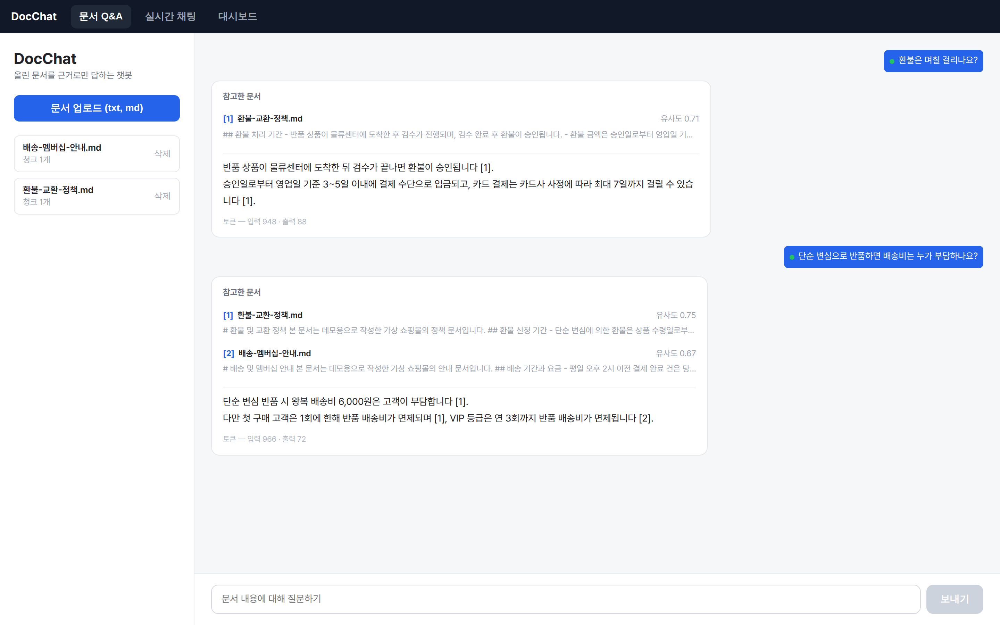
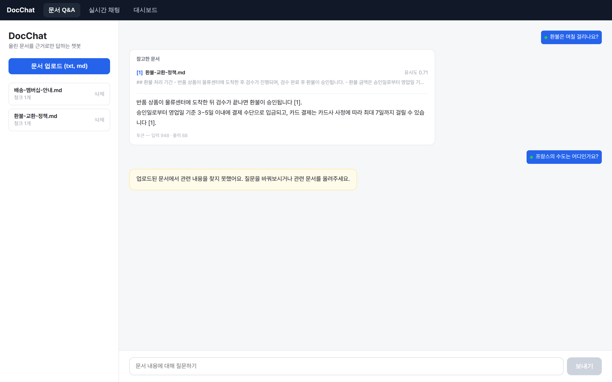
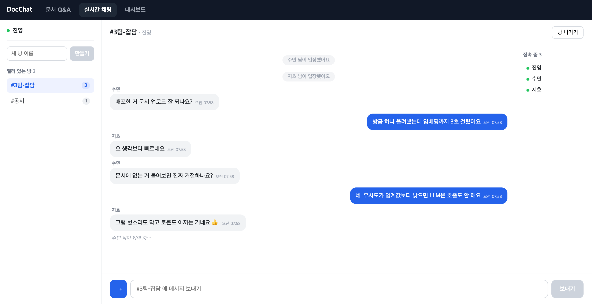
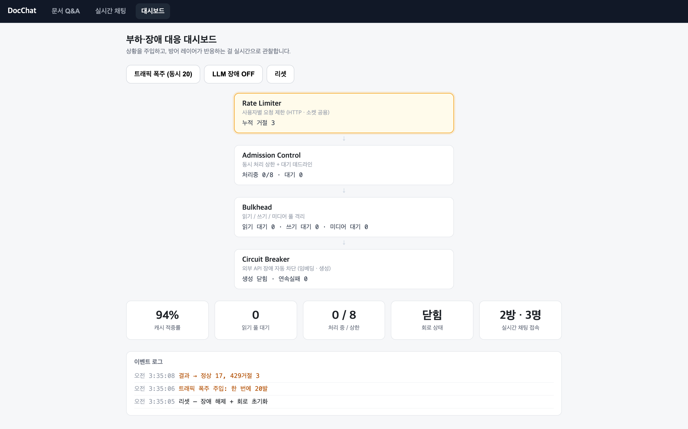
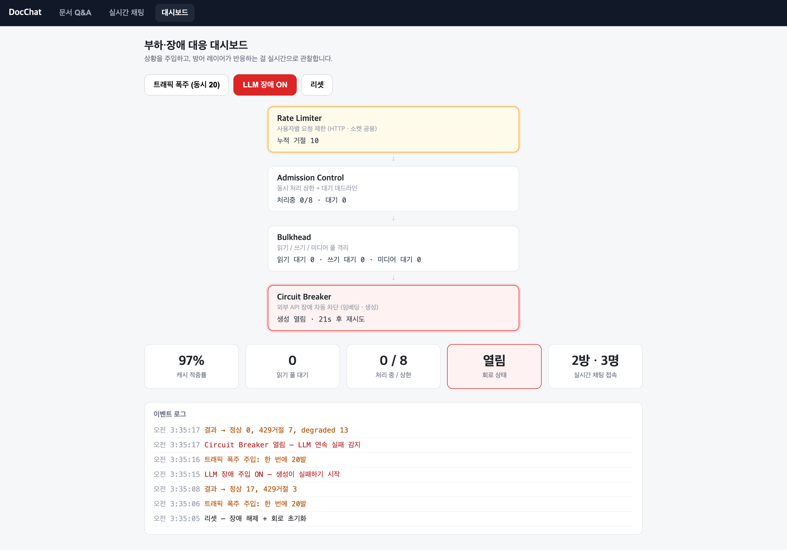

[한국어](PORTFOLIO.md) | **日本語** | [English](PORTFOLIO.en.md)

# DocChat

ドキュメントをアップロードすると、その内容だけを根拠に回答するRAGチャットボット。
ドキュメントにない質問には作り話をせず拒否し、回答ごとに根拠の出典を表示する。複数人が
同じ部屋で会話するリアルタイムチャットも、同じサーバーに載せている。

- リポジトリ: https://github.com/JINWORLD13/docchat
- スタック: TypeScript · React (Vite) · Node/Express · PostgreSQL + pgvector ·
  Socket.IO · Gemini API
- ローカル実行: 下記[実行](#実行)の3ステップ

---

## デモ

### 回答には必ず根拠を添える



質問を投げると、参照したドキュメントと類似度(0.75、0.67)が先に表示され、その下に回答が
一文字ずつ流れてくる。文末の[1]、[2]は上の出典番号とそのまま対応している。
入力・出力トークンも併せて記録し、コストを追跡する。

### ドキュメントになければ作り話をしない



検索の最高類似度がしきい値(0.62)を下回れば拒否する。
このときLLMは**呼び出しすらしない** — もっともらしい嘘(ハルシネーション)を防ぐと同時に、
トークンとレイテンシを節約する。

### 同じサーバーで動くリアルタイムチャット



ニックネームを決めると、ロビーで部屋を作るか選んで入る。部屋一覧の人数、接続者、
入室の通知、相手が入力中であることの表示まで、すべてソケット1本でやり取りする。
部屋は空になれば消える — 誰もいない部屋を一覧に残す方法がないので、
部屋の作成と入室を同じ操作にした。

回答のトークンはSSE(一方向)、チャットはWebSocket(双方向1:N)と性質は異なるが、
プロセスは1つだ。なぜ分けなかったかは下の[アーキテクチャ](#アーキテクチャ)に書いた。

### 負荷・障害対応ダッシュボード

防御ロジックが「いつ発動したのか」を目で確認できなければ、障害時に判断ができない。
そこで、状況をボタンで注入し、反応をリアルタイムで観察できる画面を作った。



同時20件を撃ち込むと、Rate Limiterがバケットに残ったトークンを超えるリクエストを429で
弾く (正常17、拒否3)。回路は閉じたままで、サービスは正常。

バケット容量が10なので算術的には10件が弾かれるはずだが、実際に弾かれたのは3件だった。
ブラウザが1つのオリジンへ張る同時接続を6本(HTTP/1.1)までに抑えるため、20件が一度には
出ていかず、およそ2秒に分散して流れたからだ。その間にトークンが毎秒5個ずつ補充され、
大半が通過した。理論値と測定値が分かれる地点なので書き残しておく —
何で負荷をかけるかが、そのまま測定条件になる。ブラウザを経由しない
`MODE=burst node scripts/demo-defense.ts`は、同じ制限でも理論値に近い拒否数を出す。



LLM障害を注入すると連続失敗が積み重なってサーキットブレーカー(Circuit Breaker)が
開き(赤)、以降のリクエストはLLMを呼び出すことなくdegraded(出典のみ)で応答する。
**20件中ハードエラーは0** — ユーザーは回答の要約を失うだけで、
関連ドキュメントはそのまま受け取れる。

設計の根拠と測定値は[RELIABILITY.ja.md](RELIABILITY.ja.md)にまとめた。

---

## アーキテクチャ

```
  ブラウザ (React)
     │  質問 (POST, SSEで応答を受信) · チャット (WebSocket) · 画像 (POST → id)
     ▼
  Express サーバー + Socket.IO  (1プロセス · 同じポート 4000)
     │
     ├─ チャット: ソケット → 連投制限(Token Bucket) → 同じ部屋へブロードキャスト
     │
     ├─ 画像: HTTPアップロード → 先頭バイトで形式を判別(SVGは除外) → 保存
     │        ソケットにはidだけ · アドレスはサーバーが生成 · 取得は専用プール(mediaPool)
     │                                       │
     ├─ 取り込み: ファイル → チャンキング(重複) → 埋め込み → 保存
     │                                       │
     │                                       ▼
     │                              PostgreSQL + pgvector
     │                              (文書 · 断片+ベクトル · 質問ログ · チャット画像)
     │                                       ▲
     └─ 質問: 質問 → 埋め込み → ベクトル検索 top5
                                │
                                ├─ 類似度 < 0.62 → 拒否 (LLMを呼ばない)
                                │
                                └─ 通過 → 抜粋をプロンプトへ
                                              │
                                              ▼
                                     Gemini API (生成, ストリーミング)
```

ドキュメントQ&Aの核心は2つのフローだ。ドキュメントを取り込むフロー(チャンキング →
埋め込み(エンベディング) → 保存)と、質問するフロー(検索 → 拒否判定 → 生成)。生成の
呼び出しは最後の一片にすぎず、その手前の検索と拒否こそがこのプロジェクトの本体である。
チャットは転送方式が違うだけで同じプロセスに載っており、rate limitのような防御ロジックを
ドキュメントQ&Aと共有している。

---

## 技術選定とその理由

検索ストレージにpgvector。専用ベクトルDB(Pineconeなど)を導入するとインフラが1つ増え、
ドキュメントのメタデータは Postgres・ベクトルは別DBと分かれて同期が面倒になる。pgvectorは
Postgresに vectorカラムを1つ足すだけなので、メタデータのジョインとベクトル検索がSQL 1回で
完結する。個人・中小規模にはこちらの方がシンプルだ。

オーバーラップ付きチャンキング。ドキュメントを単語200個(空白区切り)単位で切り分けつつ、
40個ずつ重ねる。オーバーラップがないと「返金は3〜5日かかる」のような文がチャンクの境界で
真っ二つに切れ、どのチャンクも完全な答えを持てなくなる。オーバーラップは
境界にまたがる文を救う保険だ。

類似度しきい値による拒否。無関係な抜粋を無理やり詰め込んで生成すると、
もっともらしい嘘(ハルシネーション)が出てくる。そこで検索の
最高類似度がしきい値未満ならLLMを呼び出さずに拒否する。ハルシネーションを防ぎ、トークンも
節約できる。

回答はSSE、チャットはWebSocket。1つのアプリに「リアルタイム」が2つあるが、性格が違う。
回答のトークンはサーバーからクライアントへ流れる一方向の1:1なのでSSEで十分だ — HTTPの
上でそのまま動くので、プロキシも再接続もタダで手に入る。一方チャットは双方向で、1人の
発言を部屋全体(1:N)へ押し出す必要があるためWebSocketが適している。転送方式は
好みではなく、必要な方向が決めた。

それでもサーバーは分けなかった。転送方式が違うことと、プロセスを分ける理由があることは
別の話だ。同じExpressのHTTPサーバー1つにSocket.IOを取り付け、ポート・デプロイ・CORSを
1つに保ち、防御ロジックも共有している。統合して初めて重複が見えた — HTTPリクエスト制限と
チャットの連投制限が、同じToken Bucketをそれぞれコピーして持っていた。これを
server/tokenbucket.tsの1箇所に抽出し、両者が共有して値だけを変える(HTTPは
容量10・毎秒5個補充、チャットは5・2)。分けるべきなのは、2つのトラフィックの規模が
大きく離れ、それぞれ独立にスケールさせる必要が出たときだ。

バケツのキーをsocket.idにしていたが作り直し、そのあともう一度作り直した。最初はチャットの
バケツをソケット単位で持ち、disconnect時に`drop()`で正確に回収する方がIPベースより
綺麗だと考えていた。回収は実際に綺麗だったが、制限が何も防げていなかった —
socket.idは接続のたびに新しく生まれるので、「5発撃って切って繋ぎ直す」と毎回新しい
バケツを満タンで受け取る。制限が連投の速さではなく、再接続の速さだけにかかっていた
わけだ。そこでキーを、再接続しても付いてくる値(IP)に変えた。

ここまでやって「直した」と文書に書いたのだが、後で測り直したら直っていなかった。回収を
`drop()`のまま残していたからだ — IPごとに生きているソケットを数え、最後の1つが切れたら
そのIPのバケツを消していた。一人で接続している人にとっては、その「最後のソケット」が
自分自身なので、切った瞬間に予算が消え、繋ぎ直せば満タンだった。キーを変えただけで、
迂回経路はそのままだったわけだ。同じ時間・同じ物量で測り直すと、接続を維持したままなら
9発のところ、切って繋ぎ直すやり方では20発が出ていった。

まとめると規則は2つだった。**キーは攻撃者が変えられない値で決め、制限の寿命は接続の
寿命より長く取る。** 接続が終わったと分かったからといって、その人が使った予算まで
忘れてよいわけではない — 終了のシグナルは回収の時点を決める根拠としては正しいが、
制限を消す根拠としては間違っていた。そこで回収もHTTP側と同じアイドルの`sweep()`に変え、
この挙動(「切って繋ぎ直しても予算は戻らない」)をテストで固定した。さらにIPごとの
同時接続数の上限を加え、接続をいくつも開いて制限を掛け算する道も閉じた。

画像は内容で判別し、SVGはそもそも受け取らない。チャットに投稿された画像の形式を、
ファイル名やContent-Typeで決めることはしない。どちらもクライアントが
書いて寄こす値なので、`evil.html`を`cat.png`という名前に`image/png`のタイプを
付けて送ることができる。そこでアップロードされたバイト列の
先頭にある固定シグネチャ(magic bytes)を自分で読み、png·jpg·gif·webpだけを
通す(server/imagetype.ts)。拡張子もその判別結果から決まる。許可リストからSVGを
意図的に外したのも同じ判断だ — SVGはXMLなので`<script>`を含められ、そのファイルを
後で同一オリジンからブラウザへ配信した瞬間、保存型XSSになる。ラスター形式だけを
受け取ればこの問題は丸ごと消えるし、magic bytesで濾すやり方とも噛み合う(SVGには
固定シグネチャがない)。レスポンスには`X-Content-Type-Options: nosniff`も併せて付け、
ブラウザがこちらの決めたタイプを無視して中身を覗き、自分で型を決め直す道も塞ぐ。
判別器を純粋関数として切り出したおかげで、「拒否すべきものを拒否できるか」を
単体テスト8件で固定できた。

バイト列はソケットに載せず、アドレスはサーバーが作る。画像はまずHTTPで
アップロードし(POST /api/chat/image)、ソケットには発行されたidだけを送る。ソケットに
バイト列を載せると、写真1枚が部屋の人数分だけ複製されて流れ、メモリに持つ直近50件の
履歴にも写真がそのまま溜まる。アップロードがURLではなくidだけを返すのも意図的だ —
クライアントがURLを決められると、`https://evil.example.com/tracker.gif`のようなアドレスを
部屋全体に撒き、そこにいる人のブラウザに他人のサーバーへリクエストを
送らせることができてしまう。サーバーは受け取ったidが自分の発行したものかを確認してから、
はじめてアドレスを付ける。保存はPostgresの`chat_images`にbyteaで行い、取得は
読み取りプールではなく専用プール(mediaPool)へ隔離した。画像の取得はメッセージが
表示されるたびに走る頻繁で重い読み取りなので、質問検索用の読み取りプールに載せると、
写真の多い部屋ひとつがこのプロジェクトが「死守する」と言った経路を
飢えさせてしまうからだ。

TypeScriptへ、ビルド段階なしで。サーバー・フロントエンドをすべてTypeScriptへ移したが、
ビルド成果物は作らない。Node 24が実行時に型だけを剥がす(type stripping)ので
`node index.ts`でそのまま動き、`tsc`は`npm run typecheck`で検査するだけだ(noEmit)。
dist/も、tsxのような別ランタイムも要らない。代償は、相対importに実際のファイル名を
そのまま書く必要があること(`./db.ts`) — Nodeは`./db.js`をdb.tsに読み替えて探しては
くれない。フロントエンドはViteがバンドルするため`tsc -b && vite build`でビルドする。

移して実際に得たもの。抽象的な安全性ではなく、具体的に2つ引っかかった。
1つ、`/api/metrics`のレスポンスの形をserver/types.tsの`MetricsResponse`という1箇所に
置き、サーバー・計測スクリプト・ダッシュボードが共有するようにしたところ、Bulkheadで
DBプールを読み取り/書き込みに分割した後、負荷計測スクリプトが消えた`m.pool.total`を
読み続けていたことがコンパイルで表に出た。JSのときは画面にundefinedが出るだけで、誰も
気づかなかった。2つ、ソケットのイベント契約をジェネリック型で固定した。HTTPはパスを
間違えれば404が返るが、ソケットのイベントは名前が文字列なので、`"typing"`を`"typeing"`と
書いてもエラーすら出ず、静かに何も起こらない。だから型で捕まえる利得がHTTP側より大きい。

---

## ぶつかった問題と解決

### 1. 拒否のしきい値を勘ではなくデータで決めた

最初はしきい値を0.5にしていたが、「フランスの首都は?」(프랑스 수도?)のような
無関係な質問でも類似度が 0.53と出てゲートを通過してしまった。

勘で引き上げる代わりに、サンプルドキュメントに対して関連する質問5個と無関係な質問4個を
実際に投げて類似度を測定した。

```
関連する質問   0.662 ~ 0.744
無関係な質問   0.527 ~ 0.587
```

2つの分布の間に明確なギャップがあったため、その中間の0.62に決めた。さらにこの値を
ハードコーディングせず環境変数に切り出し、質問ごとにquery_logsへ残る類似度を
見て再調整できるようにした。

### 2. 外部APIの一時的なエラーをリトライで耐えた

開発中、埋め込み(エンベディング)APIが503(一時的なサービス不可)を返して回答が失敗するのを
目にした。一時的なエラー(429、5xx)だけを指数バックオフでリトライし、400・404のように
リトライしても無駄なエラーは即座に失敗させるよう切り分けた。

```ts
const RETRYABLE = new Set([429, 500, 503, 504]);

async function withRetry<T>(fn: () => Promise<T>): Promise<T> {
  const delays = [500, 1000, 2000];        // 0.5s → 1s → 2s
  for (let attempt = 0; ; attempt++) {
    try { return await fn(); }
    catch (e) {
      const wait = delays[attempt];        // なければ = リトライを使い切った
      if (!RETRYABLE.has(statusOf(e)) || wait === undefined) throw e;
      // ジッター: 同時に失敗したリクエストが同じ時刻に再び殺到しないよう散らす
      await new Promise((r) => setTimeout(r, wait / 2 + Math.random() * wait));
    }
  }
}
```

### 3. 文書がコードより先に進んでいた箇所を見つけて巻き戻した

このプロジェクトで一番大きく学んだことだ。防御レイヤーを作るたびに「何を防いだのか」を
文書に書いていたのだが、後からその主張を一つずつ実際に攻撃してみると、**4箇所は実際には
防げていなかった。** コードが間違っているより悪い状態だ — 間違っているものを
正しいと書いてしまっていたのだから。

| 文書がした主張 | 実際 | なぜ食い違ったか |
|---|---|---|
| 「trust proxyは1に固定した」 | コードの既定値は0、デプロイ設定に値なし | コードは安全に直したのに、デプロイ設定への反映を漏らした |
| 「ソケットのオリジンをロックした」 | どのオリジンからでも接続できた | `cors`オプションはヘッダーを付けるだけで拒否せず、WebSocketはCORSの対象外 |
| 「再接続による迂回を塞いだ」 | 切って繋ぎ直せば予算がリセット | キーは直したが、回収のコードが迂回を復活させた |
| 「タブを閉じれば生成を中断する」 | 上流は最後まで生成(課金) | `for await`を抜けても、すでに開いたHTTPレスポンスは閉じない |

共通点が見えた。4つとも**自分が書いたロジックではなく、そのロジックが接する境界で**
食い違っていた — フレームワークの設定、ライブラリの既定の挙動、デプロイ環境、SDKの
キャンセル規約。ロジックはテストで守っていたが、境界は誰も見ていなかった。

そこで2つ変えた。1つ、主張する挙動ごとにテストを付けた(上の4つのうち3つは、いまは
`clientip.test.ts`·`origins.test.ts`·`realtime/ratelimit.test.ts`が守っている)。2つ、
直す前に実際に攻撃して再現することから始める — 悪意あるオリジンからソケットを繋いでみて、
XFFを変えながら撃ってみて、他人のニックネームで他人のメッセージを消してみて、
フィールド数十万個のリクエスト1つでメモリを130MBから300MBまで押し上げてみた
(同時に4つなら550MB、無料枠の上限が512MBである)。
再現できないものは、直したところで直ったかどうか分からない。

### 4. 表示用の名前と、権限の根拠を分離した

チャットの「ルームの削除」と「送信の取り消し」を、ニックネームで認可していた。
ログインがないので、それが持っている唯一の身元だと考えていたし、その限界は文書にも
書いていた。

問題は、それが単なる限界ではなく、破壊的な操作の迂回路だったことだ。ニックネームは
吹き出し・接続者一覧・ルーム一覧ですべて公開され、メッセージのidもルーム全体へ
ブロードキャストされ、ニックネームの登録はいつでも送り直せる。つまり他人の名前を
そのまま書いて送れば、他人のルームを消し、他人がアップロードした写真を
**DBのバイト列まで全員から**消すことができた。取り返しがつかない。

アカウントを付けるのが正解だが、その手前でも「表示される名前」と「権限の根拠」を
同じ値で使わないことはできた。

```
clientKey   ブラウザが作って保管する任意の値。サーバーにしか行かず、他人には出ない
authorId    clientKeyをサーバーの秘密鍵でHMACした値。公開しても逆算できない
```

画面はauthorIdで「自分のもの」を判断し(取り消しボタン)、サーバーは同じ値で権限を
確認する。他人のauthorIdを見ても、自分のclientKeyからその値は出てこないので真似できない。
`socket.id`で紐づける方法は使えない — 再接続のたびに変わるので、リロード1回で自分の
ルームを消せなくなる。アカウントではなく「このタブ」レベルの身元だという限界は
そのままだが、**公開される値で認可しない**という原則は守られる。

---

## 測定した指標

実ユーザーの指標はない(個人のデモ)。代わりに自分で測定した値である。

応答速度(query_logsの記録基準)

| ケース | 所要時間 | 備考 |
|---|---|---|
| 拒否(ドキュメントにない質問) | 約0.5秒 | 埋め込み+検索のみ、LLM呼び出しなし |
| 回答 | 約3〜8秒 | 埋め込み+検索+生成の全体。ストリーミングなので最初の文字はもっと早く表示される |

トークン使用量(質問あたり)

| 区分 | 値 |
|---|---|
| 入力トークン | 約900 |
| 出力トークン | 15〜260(回答の長さによる) |

検索品質

関連する質問と無関係な質問の類似度が0.66〜0.74対0.53〜0.59と明確に分かれた。この
ギャップこそが、拒否ゲートが実際に機能している根拠である。

テスト

単体テスト96個通過(`npm test`)。外部依存なしで回る純粋ロジックに集中した。

| 対象 | 件数 | 検証内容 |
|---|---|---|
| チャンキング | 3 | 短いテキストは1チャンク、長いテキストはオーバーラップしながら分割、オーバーラップ区間の一致 |
| Rate Limiter | 4 | 容量分は通過・超過分は429、IPごとの分離、時間経過によるトークン補充 |
| Token Bucket | 8 | バースト許容・超過は拒否、待ち時間の通知、補充の上限、キーごとの分離、drop・sweepでの回収 |
| サーキットブレーカー(Circuit Breaker) | 9 | しきい値到達でオープン、成功時にカウンターリセット、クールダウン後の復旧、半開きでは試験リクエスト1件だけ |
| Admission Control | 6 | 上限まで通過、キューへの譲歩、キュー飽和時の即時拒否、待機デッドライン |
| チャットの部屋管理 | 31 | 退出時に一覧から削除(幽霊ユーザー防止)、空き部屋の掃除(メモリリーク防止)、履歴は50件まで、部屋ごとの分離、部屋の無限増殖の防止、ニックネームが同じでも他人のものは消せない、存在しない部屋に来たメッセージが部屋を復活させない |
| ソケットのペイロード防御 | 6 | ペイロードがnull·数値·空オブジェクトで来てもハンドラーが落ちない |
| アップロード形式の判別 | 8 | 先頭バイトでpng·jpg·gif·webpを判別、拡張子をファイル名ではなく内容で決定、SVG·HTMLの偽装を拒否、空のファイル·切れたファイルでも落ちない |
| クライアントIPの判定 | 8 | プロキシ背後で本当のIPを選ぶ — ホップ数が0なら全員が1つのIPにまとめられ、実際より大きければヘッダーを信じて迂回される |
| オリジンの判定 | 8 | 他人のサイトは遮断し、同一オリジン(まとめてデプロイした自分の画面)は通過、サフィックス偽装は拒否 |
| ソケットの連投制限 | 5 | 切って繋ぎ直しても予算が戻らない、IPごとの同時接続数の上限 |

防御レイヤーがこのプロジェクトの核心的な主張であるため、主張する動作をテストで固定した。
Token Bucketは`take(key, now)`のように時刻を引数で受け取る形にして、sleepなしに時間を
注入し補充の挙動を決定的に検証している。

「ソケットのペイロード防御」の行は後から付いた。ハンドラーが引数をそのまま
分割代入していたのだが(`socket.on("message", ({ text }) => ...`)、
型は`{ text: string }`を約束してもそれはコンパイル時の話で、実際には`null`も来る。
すると分割代入でTypeErrorが出て、Socket.IOがリスナーをtry/catchなしで呼ぶせいで
プロセスが丸ごと死ぬ — ブラウザのコンソールで`socket.emit("message")`と1行打つだけで、
接続者全員が切断された。型が守ってくれる範囲と守ってくれない範囲(信頼境界)を、
このとき明確に分けた。

---

## コアロジックの抜粋

拒否ゲート — このプロジェクトのアイデンティティ (server/routes/chat.ts)

```ts
const topSimilarity = rows[0]?.similarity ?? 0;

if (rows.length === 0 || topSimilarity < THRESHOLD) {
  send({ type: "refusal", message: "문서에서 관련 내용을 찾지 못했어요" });
  res.end();          // ここで終わり — AIを呼びもしない
  return;
}
```

ベクトル検索 — pgvectorのコサイン距離 (server/routes/chat.ts)

```sql
select c.content, d.filename,
       1 - (c.embedding <=> $1::vector) as similarity   -- <=> は距離、1- で類似度に
  from chunks c
  join documents d on d.id = c.document_id
 order by c.embedding <=> $1::vector                     -- 近い順
 limit 5
```

オーバーラップ付きチャンキング (server/chunk.ts)

```ts
const step = size - overlap;                 // 200 - 40 = 160
for (let start = 0; start < words.length; start += step) {
  chunks.push(words.slice(start, start + size).join(" "));
  if (start + size >= words.length) break;
}
```

ソケットのイベント契約 — タイプミスをコンパイルで捕まえる仕掛け
(server/realtime/types.ts)

```ts
// クライアント → サーバー (サーバーが聞くイベント)
export interface ClientToServer {
  hello: (payload: { nickname: string }) => void; // ニックネーム登録 → ロビーへ
  join: (payload: { room: string }) => void;      // 入室 (なければ作成) / 部屋の移動
  leave: () => void;                              // 部屋だけ出てロビーへ
  message: (payload: { text: string }) => void;
  image: (payload: { imageId: string }) => void;  // バイト列ではなくidだけ (下の画像の項)
  typing: () => void;
}
// helloとjoinを分けた理由: ニックネームはロビーで一度決め、部屋はその後何度でも
// 移動する。1つのイベントにまとめると部屋を移るたびにニックネームを載せ直すことになり、
// その値が毎回違ってもサーバーには知りようがない。
// (ServerToClientは rooms / history / message / presence / system / typing / chatError)

// この契約をジェネリックで渡すと、emit/on の名前とpayloadが型検査を受ける
const io: Server<ClientToServer, ServerToClient, ..., SocketData> =
  new Server(httpServer, { ... });
```

全コードはリポジトリを参照。負荷・障害対応の設計根拠と測定値は
[RELIABILITY.ja.md](RELIABILITY.ja.md)に別途まとめてある。

---

## 限界と今後

- 会話のコンテキスト(マルチターン)がない。質問単位で動作する。
- PDFはパース品質のばらつきが大きいため、txt・mdに集中した。
- 検索が埋め込みの類似度1つに依存している。
  キーワード検索を組み合わせるハイブリッド検索が次の候補だ。
- 拒否のしきい値をログを見ながら手動で調整している。正解付きの質問セットで
  自動測定するのが次の目標だ。今の状態では、しきい値を変えたときに良くなったのか
  悪くなったのかを言う根拠が、ログを目で見ることしかない。
- チャットにアカウントがない。ニックネームは表示用で、権限はブラウザに保管した鍵から
  出るため(上の4番)、そのタブを離れると同一人物であることを証明し続けられない。
  別の端末から自分のルームを消すにはアカウントが必要だ。
- リアルタイムチャットの部屋の状態と直近の履歴がサーバーのメモリ上にある。
  サーバーが落ちれば消え、サーバーを複数台に増やせば部屋が分裂する。永続化と
  Redisアダプターが次の段階だ。
  (ドキュメントQ&A側のインメモリキャッシュが1台前提なのと同じ限界である。)
- 検証がまだ単体テストの水準だ。push·PRごとの型検査·テスト·ビルドはCIが回すが
  (`.github/workflows/ci.yml`)、上の3番で見落としていたものはすべて境界で起きた —
  ソケットのオリジンやCSRFのように、実際にサーバーを立てないと確認できない挙動は
  今回は手で再現して確認しており、これを統合テストへ引き上げるのが次の候補だ。

---

## 実行

```bash
# DB (pgvector 同梱)
docker compose up -d

# サーバー
cd server && cp .env.example .env   # GEMINI_API_KEY を入力
npm install && npm run dev

# フロントエンド
cd web && npm install && npm run dev   # http://localhost:5173
```

テストとダッシュボードのデモ:

```bash
cd server && npm test                # 単体テスト96件
cd server && npm run typecheck       # tscは検査のみ (ビルド成果物なし)
cd server && npm run start:demo      # mock LLMモード — ダッシュボードで障害注入をデモ
```
