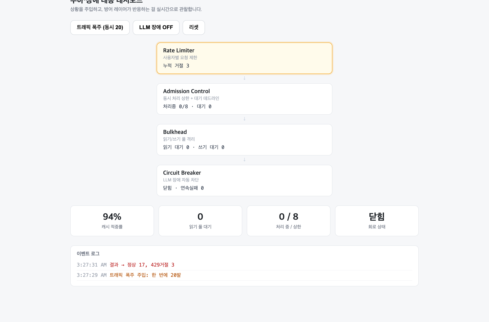

**한국어** | [日本語](PORTFOLIO.ja.md)

# DocChat

문서를 업로드하면 그 문서 내용만 근거로 답하는 RAG 챗봇.
문서에 없는 질문은 지어내지 않고 거절하며, 답변마다 근거 출처를 표시한다.

- 저장소: https://github.com/JINWORLD13/docchat
- 스택: React (Vite) · Node/Express · PostgreSQL + pgvector · Gemini API
- 로컬 실행: 아래 [실행](#실행) 세 단계

---

## 데모

### 답변은 항상 근거와 함께


질문을 던지면 참고한 문서와 유사도(0.75, 0.67)가 먼저 뜨고, 그 아래로 답변이
한 글자씩 흐른다. 문장 끝의 [1], [2]는 위 출처 번호와 그대로 연결된다.
입력·출력 토큰도 함께 남겨 비용을 추적한다.

### 문서에 없으면 지어내지 않는다


검색 최고 유사도가 임계값(0.62) 아래면 거절한다. 이때 LLM은 **호출조차 하지 않는다** —
헛소리를 막는 동시에 토큰과 지연을 아낀다.

### 부하·장애 대응 대시보드

방어 로직이 "언제 발동했는지" 눈으로 볼 수 없으면 장애 상황에서 판단할 수 없다.
그래서 상황을 버튼으로 주입하고 반응을 실시간으로 관찰하는 화면을 만들었다.



동시 20건을 쏘면 Rate Limiter가 버킷 용량(10)을 넘는 요청을 429로 막는다
(정상 17, 거절 3). 회로는 닫힌 채 서비스는 정상.


LLM 장애를 주입하면 연속 실패가 쌓여 Circuit Breaker가 열리고(빨강), 이후 요청은
LLM을 부르지도 않고 degraded(출처만)로 응답한다. **20건 중 하드 에러는 0** —
사용자는 답변 요약만 잃고 관련 문서는 그대로 받는다.

설계 근거와 측정값은 [RELIABILITY.md](RELIABILITY.md)에 정리했다.

---

## 아키텍처

```
  브라우저 (React)
     │  질문 (POST, SSE로 응답 수신)
     ▼
  Express 서버
     │
     ├─ 넣기: 파일 → 청킹(겹침) → 임베딩 → 저장
     │                                  │
     │                                  ▼
     │                         PostgreSQL + pgvector
     │                         (문서 · 조각+벡터 · 질문로그)
     │                                  ▲
     └─ 묻기: 질문 → 임베딩 → 벡터 검색 top5
                                │
                    ┌───────────┴───────────┐
                    │ 유사도 < 0.62 → 거절    │  (LLM 호출 안 함)
                    │ 통과 → 발췌를 프롬프트에 │
                    └───────────┬───────────┘
                                ▼
                          Gemini API (생성, 스트리밍)
```

핵심은 두 흐름이다. 문서를 넣는 흐름(청킹 → 임베딩 → 저장)과 질문하는 흐름
(검색 → 거절 판단 → 생성). 생성 호출은 맨 마지막 한 조각일 뿐이고, 그 앞의
검색과 거절이 이 프로젝트의 본체다.

---

## 기술 선택과 이유

검색 저장소로 pgvector.
전용 벡터DB(Pinecone 등)를 붙이면 인프라가 하나 늘고, 문서 메타데이터는
Postgres·벡터는 별도 DB로 나뉘어 동기화가 번거롭다. pgvector는 Postgres에
vector 컬럼 하나를 더하는 것이라, 메타데이터 조인과 벡터 검색이 SQL 한 번에
끝난다. 개인·중소 규모에는 이쪽이 단순하다.

겹치는 청킹.
문서를 어절 200개 단위로 자르되 40개씩 겹친다. 겹치지 않으면 "환불은 3~5일
걸린다" 같은 문장이 조각 경계에서 반으로 잘려, 어느 조각도 온전한 답을 갖지
못한다. 겹침은 경계에 걸린 문장을 살리는 보험이다.

유사도 임계값으로 거절.
관련 없는 발췌를 억지로 넣고 생성하면 그럴듯한 헛소리가 나온다. 그래서 검색
최고 유사도가 임계값 미만이면 LLM을 호출하지 않고 거절한다. 헛소리를 막고
토큰도 아낀다.

스트리밍은 SSE.
답변은 서버에서 클라이언트로 흐르는 단방향이라 WebSocket까지 갈 필요가 없다.
SSE가 HTTP 위에서 그대로 동작해 더 단순하다.

---

## 부딪힌 문제와 해결

### 1. 거절 임계값을 감이 아니라 데이터로 정했다

처음엔 임계값을 0.5로 잡았는데, "프랑스 수도?" 같은 무관한 질문도 유사도가
0.53으로 나와 게이트를 통과해버렸다.

감으로 올리는 대신, 샘플 문서에 관련 질문 5개와 무관한 질문 4개를 실제로
던져 유사도를 측정했다.

```
관련 질문   0.662 ~ 0.744
무관 질문   0.527 ~ 0.587
```

두 분포 사이에 뚜렷한 갭이 있어 그 중간인 0.62로 정했다. 그리고 이 값을
하드코딩하지 않고 환경변수로 빼서, 질문마다 query_logs에 남는 유사도를 보고
다시 맞출 수 있게 했다.

### 2. 외부 API의 일시적 오류를 재시도로 견뎠다

개발 중 임베딩 API가 503(일시적 서비스 불가)을 뱉어 답변이 실패하는 걸 봤다.
일시적 오류(429, 5xx)만 지수 백오프로 재시도하고, 400·404처럼 재시도해도
소용없는 오류는 바로 실패시키도록 나눴다.

```js
const RETRYABLE = new Set([429, 500, 503, 504]);

async function withRetry(fn) {
  const delays = [500, 1000, 2000];        // 0.5s → 1s → 2s
  for (let attempt = 0; ; attempt++) {
    try { return await fn(); }
    catch (e) {
      if (!RETRYABLE.has(e?.status) || attempt >= delays.length) throw e;
      await new Promise((r) => setTimeout(r, delays[attempt]));
    }
  }
}
```

---

## 측정한 지표

실사용자 지표는 없다(개인 데모). 대신 직접 측정한 값들이다.

응답 속도 (query_logs 기록 기준)

| 경우 | 걸린 시간 | 비고 |
|---|---|---|
| 거절 (문서에 없는 질문) | 약 0.5초 | 임베딩+검색만, LLM 호출 안 함 |
| 답변 | 약 3~8초 | 임베딩+검색+생성 전체. 스트리밍이라 첫 글자는 더 빨리 뜸 |

토큰 사용량 (질문당)

| 구분 | 값 |
|---|---|
| 입력 토큰 | 약 900 |
| 출력 토큰 | 15 ~ 260 (답 길이에 따라) |

검색 품질

관련 질문과 무관한 질문의 유사도가 0.66~0.74 대 0.53~0.59로 명확히 갈렸다.
이 갭이 거절 게이트가 실제로 동작하는 근거다.

테스트

단위 테스트 19개 통과 (`npm test`). 외부 의존성 없이 도는 순수 로직에 집중했다.

| 대상 | 검증 내용 |
|---|---|
| 청킹 | 짧은 글은 1조각, 긴 글은 겹치며 분할, 겹침 구간 일치 |
| Rate Limiter | 용량만큼 통과·초과분 429, IP별 격리, 시간 경과 시 토큰 충전 |
| Circuit Breaker | 임계치 도달 시 오픈, 성공 시 카운터 리셋, 쿨다운 후 복구 |
| Admission Control | 상한까지 통과, 큐 양보, 큐 포화 시 즉시 거절, 대기 데드라인 |

방어 레이어가 이 프로젝트의 핵심 주장이라, 주장하는 동작을 테스트로 고정했다.

---

## 핵심 로직 발췌

거절 게이트 — 이 프로젝트의 정체성 (server/routes/chat.js)

```js
const topSimilarity = rows[0]?.similarity ?? 0;

if (rows.length === 0 || topSimilarity < THRESHOLD) {
  send({ type: "refusal", message: "문서에서 관련 내용을 찾지 못했어요" });
  res.end();          // 여기서 끝 — AI를 부르지도 않는다
  return;
}
```

벡터 검색 — pgvector 코사인 거리 (server/routes/chat.js)

```sql
select c.content, d.filename,
       1 - (c.embedding <=> $1::vector) as similarity   -- <=> 거리, 1- 로 유사도
  from chunks c
  join documents d on d.id = c.document_id
 order by c.embedding <=> $1::vector                     -- 가까운 순
 limit 5
```

겹치는 청킹 (server/chunk.js)

```js
const step = size - overlap;                 // 200 - 40 = 160
for (let start = 0; start < words.length; start += step) {
  chunks.push(words.slice(start, start + size).join(" "));
  if (start + size >= words.length) break;
}
```

전체 코드는 저장소 참고. 흐름별 상세 설명은 STUDY.md에 정리해두었다.

---

## 한계와 다음

- 대화 맥락(멀티턴)이 없다. 질문 단위로 동작한다.
- PDF는 파싱 품질 편차가 커서 txt·md에 집중했다.
- 검색이 임베딩 유사도 하나에 의존한다. 키워드 검색을 섞는 하이브리드 검색이
  다음 후보다.
- 거절 임계값을 로그를 보며 수동으로 맞추고 있다. 정답이 있는 질문 세트로
  자동 측정하는 것이 다음 목표다.
- 클라이언트가 응답 도중 떠나도 서버는 LLM 스트림을 끝까지 소비한다.
  연결 종료를 감지해 생성을 중단하는 것이 다음 개선 후보다.

---

## 실행

```bash
# DB (pgvector 포함)
docker compose up -d

# 서버
cd server && cp .env.example .env   # GEMINI_API_KEY 입력
npm install && npm run dev

# 프론트
cd web && npm install && npm run dev   # http://localhost:5173
```

테스트와 대시보드 데모:

```bash
cd server && npm test                # 단위 테스트 19개
cd server && npm run start:demo      # mock LLM 모드 — 대시보드에서 장애 주입 시연
```
